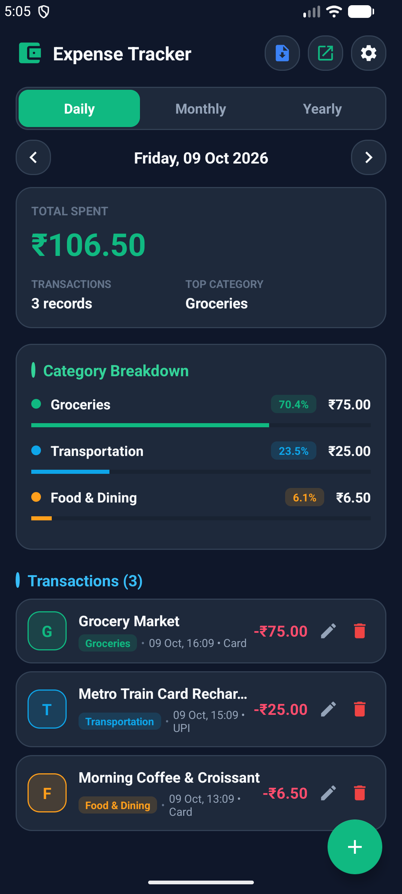
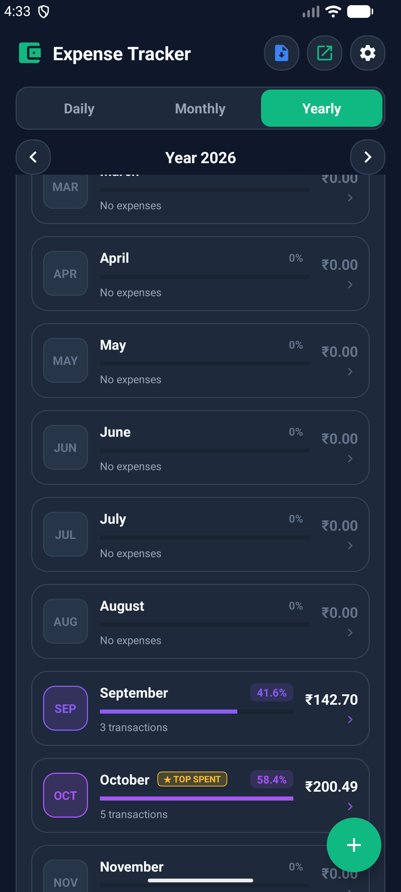
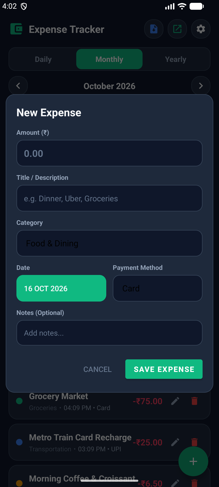

# ExpenseTracker - Daily Expenses & Financial Reports App

A modern, offline-first personal finance Android application built in **Kotlin** and **Material Design 3**. Track daily expenses, visualize spending breakdowns across Daily, Monthly, and Yearly periods, group monthly transactions by date, configure your preferred currency (**Dollar `$`** or **Rupee `₹`**), and seamlessly import/export your financial data via **PDF** and **Excel (CSV)**.

---

## 📱 App Snapshots & Visual Tour

| Daily View (Vivid Headers) | Monthly Dashboard (Eye-Catching Categories & Transactions) | Month-wise Spending (Yearly Rainbow View & Top Month) |
| :---: | :---: | :---: |
|  |  |  |

| Currency & Display Settings | Unified Export Menu | Add / Edit Expense Dialog |
| :---: | :---: | :---: |
|  |  |  |

---

## 🚀 Key Features

### 1. 🎨 Vibrant, Eye-Catching Visual Hierarchy
- **Category Breakdown**:
  - Signature emerald accent stripe.
  - Vibrant circular category indicators (`Groceries` emerald green, `Bills` electric purple, `Entertainment` neon pink, `Transportation` sky blue, `Food` warm orange).
  - Translucent percentage pill tags (`[ 37.4% ]`) color-matched to each category.
  - Thicker 8dp progress bars with high-contrast tracks and category-specific progress tints.
- **Month-wise Spending (Yearly View)**:
  - Dynamic 12-month palette giving every month a distinct, vibrant color identity.
  - Translucent squircle badges with colored borders and month abbreviation.
  - Automatic `★ TOP SPENT` gold crown highlight for the highest-expenditure month of the year.
  - Matching progress bars and interactive tap-to-drill-down month navigation.
- **Modern Transactions Section**:
  - 40×40dp squircle category avatars with 18% opacity tinted backgrounds, vibrant colored borders, and bold category initials (`G`, `T`, `F`, `B`, `E`).
  - Color-matched category pill badges (`[ Groceries ]`, `[ Transportation ]`, etc.).
  - High-visibility amount styling in vibrant rose-red (`-₹75.00`).
  - Elegant date headers with calendar badges and daily spending total pills.

### 2. 💱 Multi-Currency Support (Dollar `$` & Rupee `₹`)
- Switch anytime between **US Dollar (`$`)** and **Indian Rupee (`₹`)** in **Settings**.
- Preferences persist across app sessions via `SharedPreferences`.
- Automatically formats all overview cards, transaction list items, category breakdown bars, expense input dialogs, generated PDF reports, and exported CSV sheets.

### 2. 📅 Monthly Date Grouping with Daily Totals
- In **Monthly View**, transactions are automatically grouped under chronological date headers (e.g., `Friday, 09 Oct 2026`).
- Each header displays the total number of transactions and the net sum spent on that specific day.
- A quick **"Grouped by Date" / "Flat List"** toggle pill allows switching between grouped and standard chronological views on the fly.

### 3. 📤 Unified Export Menu (PDF & Excel CSV)
- Clean, dedicated **Export** icon button in the top bar.
- Anchored popup menu provides:
  - **Export as PDF**: Produces a clean, formatted PDF financial report ready for printing, filing, or sharing.
  - **Export as Excel (CSV)**: Generates an RFC-4180-compliant CSV file compatible with Microsoft Excel, Google Sheets, and LibreOffice Calc.
- Direct sharing via Android's native share sheet.

### 4. 📥 CSV Import & Restore Engine
- Import transactions directly from CSV files using Android's native file picker (`ACTION_OPEN_DOCUMENT`).
- **Smart Column Detection**: Automatically detects column names regardless of ordering (`Title`, `Category`, `Amount`, `Date`, `Payment Method`, `Notes`).
- **Format Flexibility**: Supports ISO dates (`yyyy-MM-dd`), localized formats (`dd MMM yyyy`, `dd/MM/yyyy`), currency symbol stripping, and quoted values.
- **Preview & Confirmation**: Shows an import summary dialog (record count and total amount) before writing to the database.
- **Atomic Batch Insertion**: Inserts records efficiently in a single SQLite transaction.

### 5. 🎨 Modern, Compact Top Bar
- Minimalist top bar with intuitive icon-only buttons:
  - 📥 **Import CSV**
  - 📤 **Export (PDF / Excel)**
  - ⚙️ **Settings**
- Strict single-line "Expense Tracker" title with dynamic auto-sizing to prevent truncation or wrapping on any screen size.

### 6. 🔒 100% Offline & Private
- All data is stored locally in an embedded SQLite database (`expenses.db`).
- Zero cloud dependencies, zero external tracking, zero analytics scripts.
- Your financial data never leaves your device.

---

## 📊 CSV Import/Export Format

The app exports and imports CSV files with standard header columns:

```csv
ID,Title,Category,Amount,Date,Payment Method,Notes
1,"Grocery Market","Groceries",75.00,"2026-10-09","Card","Weekly vegetable shopping"
2,"Metro Card Recharge","Transportation",25.00,"2026-10-09","UPI","Monthly pass refill"
3,"Morning Coffee","Food & Dining",6.50,"2026-10-09","Card","Latte and croissant"
```

> **Note**: Flexible column headers are supported (e.g. `Expense`, `Cost`, `Price`, `Description`, `Mode`, `Remarks`).

---

## 🛠️ Tech Stack & Architecture

- **Language**: Kotlin 2.0+
- **Minimum SDK**: Android API 24 (Android 7.0 Nougat)
- **Target / Compile SDK**: Android API 36
- **Architecture**: Single-Activity Architecture with modular helper components:
  - `CurrencyManager`: Manages currency selection and number formatting.
  - `ExpenseDatabaseHelper`: SQLite database persistence and atomic batch operations.
  - `ExpenseAdapter`: RecyclerView adapter with multiple view types (`DateHeader` & `ExpenseItem`).
  - `PdfReportExporter`: Android `PdfDocument` report generator with tables, headers, and totals.
  - `ExcelCsvExporter`: RFC-4180 compliant CSV export engine.
  - `CsvImporter`: Resilient CSV parser with auto-column matching.
- **UI Components**: Material Components 3, ViewBinding, Dynamic Material Cards.
- **Unit Testing**: JUnit 4 testing suite for models, currency management, and business logic.

---

## 📦 How to Build & Run

### Prerequisites
- Android Studio Ladybug / Meerkat (or newer)
- JDK 17 or JDK 21 (configured as `JAVA_HOME`)
- Android SDK Platform 36 & Build-Tools

### Build Debug APK from Terminal

```bash
# Clone the repository
git clone https://github.com/rajeevksofficial/ExpenseTrackerApp.git
cd ExpenseTrackerApp

# On Windows PowerShell:
$env:JAVA_HOME = "C:\Program Files\Android\Android Studio\jbr"
.\gradlew.bat assembleDebug

# On macOS / Linux:
export JAVA_HOME="/Applications/Android Studio.app/Contents/jbr/Contents/Home"
./gradlew assembleDebug
```

The compiled APK will be generated at:
`app/build/outputs/apk/debug/app-debug.apk`

### Run Unit Tests

```bash
# Run local unit tests
.\gradlew.bat testDebugUnitTest
```

---

## 📄 License
Open source under the [MIT License](LICENSE).
